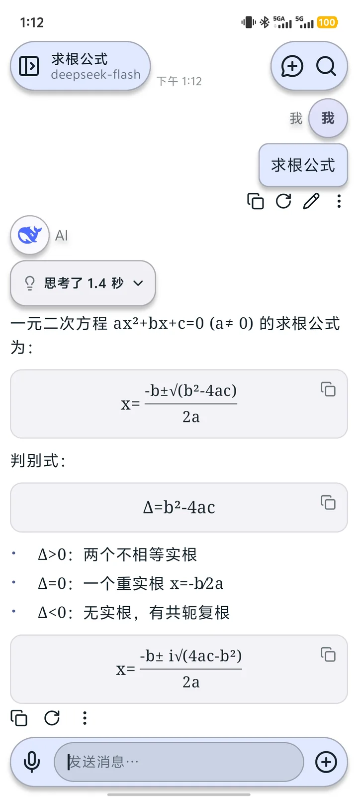
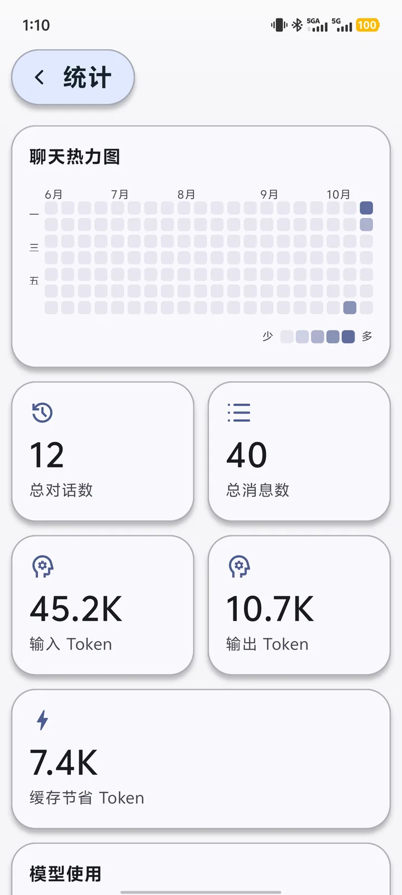

# 指尖Hub

<p align="center">
  <a href="https://fingertipfuture.top/">官网</a> ·
  <a href="https://github.com/DaYanHCD/zhijian-hub/releases/latest">下载</a> ·
  <a href="https://github.com/DaYanHCD/zhijian-hub">GitHub</a> ·
  <a href="LICENSE">MIT License</a>
</p>

> 指尖Hub-OS 是一个独立的、纯原生、本地优先的 Android AI 对话客户端。
> 它不依赖自有账号或聊天后端，用户用自己的 API Key 直连模型服务。

**当前开源版本：1.0.1**<br>
**桌面名称：指尖Hub-OS**<br>
**包名：`com.fingertipfuture.hub.os`**<br>
**系统要求：Android 7.0+**

## 下载

开源版安装包发布在 GitHub Releases，也可以从[项目官网](https://fingertipfuture.top/)下载。

- [下载最新开源版](https://github.com/DaYanHCD/zhijian-hub/releases/latest)
- [查看全部 Releases](https://github.com/DaYanHCD/zhijian-hub/releases)
- 1.0.1 安装包大小：5,488,022 字节
- SHA-256：`1b9e6dd4beac3904a9d96a20dfb2a8512272e44d04dff4197e87571ebe83f6d8`
- [第三方组件与素材许可](THIRD_PARTY_NOTICES.md)

安装包使用正式签名，不包含任何 API Key。安装后需要在应用内添加自己的模型供应商。

开源版使用独立的更新清单，发布 1.0.1 后可在「设置 → 关于 → 检查更新」中直接升级到
后续的 1.0.2、1.0.3 等版本。

## 界面

<table>
  <tr>
    <td align="center"><br><sub>新对话</sub></td>
    <td align="center"><br><sub>LaTeX 公式回答</sub></td>
    <td align="center"><br><sub>统计</sub></td>
  </tr>
</table>

## 它解决什么问题

- **不想被单一模型绑定**：内置常见供应商预设，也可以填写任意 OpenAI 兼容地址和模型名。
- **希望知道助手在做什么**：把理解问题、获取位置、整理搜索词、搜索和组织回答放进同一条思考时间线。
- **希望数据留在本机**：对话、附件、记忆、API Key 和备份默认都由用户自己掌握。

## 主要功能

- **多供应商**：OpenAI、Gemini、DeepSeek、Kimi、智谱、千问等 25 家预设，也支持自定义兼容接口。
- **流式回答**：原生 SSE 流式解析，回答边生成边显示，可以随时停止。
- **思考时间线**：展示模型的组织过程、联网搜索步骤和工具调用结果。
- **联网搜索**：支持 Bing、DeepSeek 官方搜索等服务，可设置结果条数并参与并行搜索。
- **助手与技能**：不同助手可以拥有独立的模型、参数、系统提示词、记忆和技能。
- **多模态输入**：图片、文件、位置和语音消息；长文本支持独立的全屏输入页。
- **会话管理**：历史会话、文件夹、置顶、重命名、删除、搜索与导出导入。
- **本地数据**：手写 SQLite 会话库，支持本机导出、恢复和 WebDAV 加密备份。
- **用量统计**：聊天热力图、输入/输出 Token、缓存节省、搜索费用和模型使用次数。
- **阅读体验**：Markdown、代码块、表格、LaTeX 公式，以及浅色 / 深色 / 跟随系统主题。

## 隐私与数据

指尖Hub 不运营自有聊天后端，也不要求注册账号。

- API Key 使用 Android Keystore 保护的本地密钥加密保存。
- 聊天记录和附件保存在本机 SQLite 与应用私有目录。
- 请求只发送给用户选择的模型、搜索或 WebDAV 服务。
- 应用不包含广告 SDK、统计 SDK 或第三方 UI / 网络 / Markdown 渲染库。
- WebDAV 备份在上传前由“地址 + 用户名 + 密码”派生的密钥加密。

具体说明见[隐私政策](https://fingertipfuture.top/privacy.html)。

## 技术实现

- Kotlin + Jetpack Compose + Material 3
- `HttpURLConnection` + `org.json`，没有引入 OkHttp、Retrofit 或第三方 JSON 库
- 原生 SSE 流式解析
- 手写 SQLite 数据层：会话、节点、消息、附件与用量
- Android Keystore + AES-GCM 保存本机密钥
- 单 Activity、Compose 页面状态管理，没有 WebView 和跨平台框架

## 构建

需要 JDK 17+、Android SDK（compileSdk 36）。

```bash
./gradlew assembleOpen
```

Windows：

```powershell
.\gradlew.bat -g 'D:\安卓开发环境\gradle-home' '-Dorg.gradle.java.home=D:\安卓开发环境\jdk' --no-daemon assembleOpen
```

`local.properties` 中的 SDK 路径不随仓库分发。未提供签名材料时仍可构建调试或未签名包；
仓库不包含发布密钥、API Key 或用户数据。

## 项目结构

```text
app/src/main/java/com/fingertipfuture/hub/
├── MainActivity.kt          应用入口与初始化
├── core/                    版本与应用常量
├── data/                    AI 客户端、SQLite、设置、备份、附件与搜索
├── ui/
│   ├── ChatScreen.kt        对话主页面
│   ├── chat/                消息、输入、思考时间线、副屏等组件
│   ├── settings/            设置、助手、技能、数据管理与关于页
│   └── provider/            供应商配置
├── update/                  更新清单、下载与安装逻辑
└── util/                    格式化工具
```

## 开源说明与致谢

本项目是独立项目，不是 RikkaHub 的官方分支。信息架构和交互设计参考了
[RikkaHub](https://github.com/rikkahub/rikkahub)（AGPL-3.0），但没有复制它的代码或素材。

第三方素材：

- 聊天页细线图标来自 [Lucide](https://lucide.dev)（ISC）。
- 设置与功能页图标来自 Google Material Symbols（Apache-2.0）。
- 供应商 Logo 来自 [LobeHub Icons](https://github.com/lobehub/lobe-icons)（MIT）。
- 静态与动画表情来自 Google Noto Emoji（SIL OFL 1.1）。

指尖Hub 与 OpenAI、Google、DeepSeek 等模型或搜索服务商没有隶属关系，
相关名称和商标归各自权利人所有。

## 许可证

本项目使用 MIT License，详见 [LICENSE](LICENSE)。
